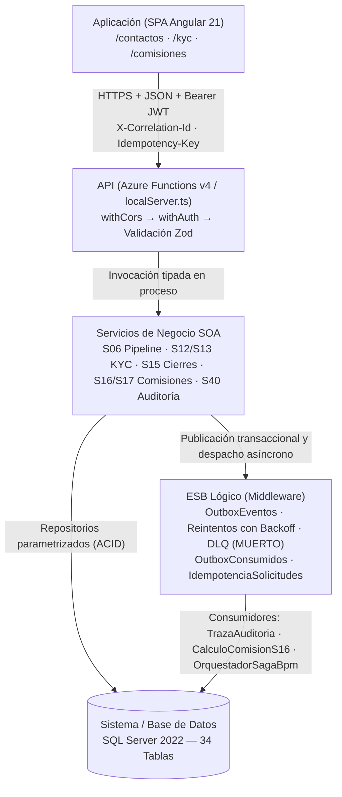

# AVANCE DE PROYECTO FINAL 3 (APF3) — Semana 15
## Implementación, Integración SOA, ESB Lógico y Orquestación BPM en MaziApp (Mazi Flow)

- **Curso:** Arquitectura Orientada al Servicio (SOA)
- **Etapa:** ETAPA 3 – APF3 (Semana 15 · Peso: 20 %)
- **Organización bajo estudio:** Mazi Financiera / Mazi Flow (Sistema de Gestión de Relaciones de Inversión — SGRI)

---

## 1. Resumen Ejecutivo

En la Etapa 1 (APF1) se diagnosticó la fragmentación de información entre la prospección comercial de inversionistas, la validación regulatoria de cumplimiento (*Compliance* / KYC) y la liquidación financiera de comisiones a ejecutivos *freelance*. En la Etapa 2 (APF2) se diseñó el inventario de servicios SOA, el modelo de composición mediante un *Enterprise Service Bus* (ESB) lógico y la orquestación de procesos mediante el patrón **Saga**.

En esta **Etapa 3 (APF3)** se materializa la implementación técnica funcional sobre un corte vertical completo y verificable de principio a fin (**S01, S06, S12, S13, S15, S16, S17, S40**, más el **ESB lógico** y el **Orquestador Saga BPM**), conectado a una base de datos **SQL Server 2022** contenerizada (34 tablas) y consumido por una aplicación **Angular 21**.

---

## 2. Selección y Definición de Tecnologías (Requisito S1)

| Componente SOA | Tecnología seleccionada | Versión | Justificación técnica en Mazi Flow |
|---|---|---|---|
| **Protocolo y estilo de API** | API REST sobre HTTP/1.1 y HTTPS | REST / OpenAPI 3.1.0 | Interoperabilidad nativa con SPA web, clientes móviles y herramientas de auditoría; contrato formal validado en `docs/openapi.yaml` (39 rutas / 51 operaciones). |
| **Formato de intercambio** | JSON (`application/json`, UTF-8) | RFC 8259 | Ligero, tipado mediante esquemas Zod y OpenAPI; fechas normalizadas en ISO 8601 UTC (`YYYY-MM-DDTHH:mm:ss.sssZ`) e identificadores `bigint` serializados como cadena para preservar precisión de 64 bits. |
| **Lenguaje de programación** | TypeScript (modo `strict`) | 5.x | Tipado estático extremo a extremo en backend y frontend, evitando discrepancias entre contratos de servicio y persistencia. |
| **Servidor y Framework Backend** | Node.js + Azure Functions v4 + Wrapper HTTP local (`localServer.ts`) | Node 22.x / `@azure/functions` 4.x | Arquitectura orientada a eventos serverless; en desarrollo local incluye un servidor HTTP ligero (`http://localhost:7071/api`) que enruta los handlers y sirve Swagger UI (`/api/docs`) sin requerir el runtime de la nube. |
| **Framework Frontend (Aplicación)** | Angular (Standalone Components + Signals) + Fundamental NGX | Angular 21.2 | SPA modular con guardas de rol (`authGuard`, `roleGuard`), interceptores HTTP y vistas dedicadas para Contactos (`/contactos`), KYC (`/kyc`) y Comisiones (`/comisiones`). |
| **Seguridad e Identidad** | Microsoft Entra ID (MSAL / JWT Bearer) + RBAC por App Roles | `jsonwebtoken` 9.x / `jwks-rsa` 4.x | Autenticación sin estado basada en tokens firmados y autorización por rol (`ejecutivo_inversion`, `compliance`, `administracion`, `direccion_comercial`, `gerencia_general`) más control de pertenencia a cartera (*anti-enumeración*). |
| **Base de datos** | Microsoft SQL Server 2022 (T-SQL) | 2022 (Docker `maziapp-sql`) | Integridad referencial y contable en el motor: 34 tablas, 23 claves foráneas, 43 restricciones `CHECK`, 18 `UNIQUE`, disparador de inmutabilidad `TR_AuditoriaEventos_SoloAnexado` y vista `vw_OportunidadResumen`. |
| **ESB / Middleware de integración** | Bus de Servicios Empresarial Lógico sobre SQL Server | Transactional Outbox + DLQ + Idempotencia | Implementa mediación, enrutamiento a consumidores suscritos, transformación al sobre canónico `MensajeEsb`, reintentos con *backoff* exponencial (`ESB_BACKOFF_BASE_SEGUNDOS`), cola de mensajes fallidos (`MUERTO` / DLQ), consumo idempotente (`OutboxConsumidos`) e idempotencia HTTP (`IdempotenciaSolicitudes`). |

---

## 3. Diseño Técnico de los Servicios Implementados (Requisito S2)

Todos los servicios comparten el prefijo base `http://localhost:7071/api`, formato `application/json`, autenticación `Authorization: Bearer <token>` y trazabilidad mediante la cabecera `X-Correlation-Id` (aceptada desde el cliente o generada por el backend y devuelta siempre en la respuesta).

### 3.1 Resumen del Catálogo de Endpoints Implementados en APF3 (29 operaciones nuevas + 22 de base)

| Servicio SOA | Método y Endpoint | Roles autorizados (`x-required-roles`) | Propósito y reglas técnicas clave |
|---|---|---|---|
| **S06 · Pipeline** | `GET /api/pipeline/etapas` | `ejecutivo_inversion`, `direccion_comercial`, `gerencia_general` | Devuelve el catálogo ordenado de las 8 etapas del pipeline (`PROSPECTO` a `CERRADO_GANADO`). |
| **S06 · Pipeline** | `GET /api/pipeline/oportunidades` | `ejecutivo_inversion`, `direccion_comercial`, `gerencia_general` | Listado paginado (`{ items, page, pageSize, total }`) sobre `vw_OportunidadResumen`; el ejecutivo solo ve su cartera. |
| **S06 · Pipeline** | `POST /api/pipeline/oportunidades` | `ejecutivo_inversion` | Crea oportunidad en la primera etapa activa, registra hito inicial, audita en S40 y publica `EtapaCambiada` en el outbox. |
| **S06 · Pipeline** | `GET /api/pipeline/oportunidades/{oportunidadId}` | `ejecutivo_inversion`, `direccion_comercial`, `gerencia_general` | Detalle de la oportunidad con su etapa, estado KYC, cierre y comisión. |
| **S06 · Pipeline** | `POST /api/pipeline/oportunidades/{oportunidadId}/avanzar` | `ejecutivo_inversion` | Avance estrictamente secuencial con `UPDATE` condicional (`rowsAffected = 1`); entrar a `CERRADO_GANADO` exige KYC `VALIDADO` y cierre `REGISTRADO`. |
| **S06 · Pipeline** | `POST /api/pipeline/oportunidades/{oportunidadId}/perder` | `ejecutivo_inversion` | Marca la oportunidad como `PERDIDA` con motivo obligatorio y control de concurrencia. |
| **S06 · Pipeline** | `GET /api/pipeline/oportunidades/{oportunidadId}/historial` | `ejecutivo_inversion`, `direccion_comercial`, `gerencia_general` | Historial cronológico de cambios de etapa con `correlationId`. |
| **S12 · KYC** | `GET /api/kyc/documentos-requeridos` | `ejecutivo_inversion`, `compliance` | Catálogo de los 5 documentos regulatorios (`DOC_IDENTIDAD`, `FICHA_RUC`, `SUSTENTO_FONDOS`, `DECLARACION_PEP`, `CONTRATO_FIRMADO`). |
| **S12 · KYC** | `POST /api/kyc/expedientes` | `ejecutivo_inversion`, `compliance` | Abre el expediente único de una oportunidad `ACTIVA`, genera su checklist en transacción y publica `KycEstadoCambiado`. |
| **S12 · KYC** | `GET /api/kyc/expedientes` | `ejecutivo_inversion`, `compliance` | Listado paginado de expedientes con cálculo de SLA embebido. |
| **S12 · KYC** | `GET /api/kyc/expedientes/{expedienteId}` | `ejecutivo_inversion`, `compliance` | Detalle del expediente con su checklist documental completo y SLA. |
| **S12 · KYC** | `POST /api/kyc/expedientes/{expedienteId}/documentos` | `ejecutivo_inversion`, `compliance` | Registra la recepción de un documento (`RECIBIDO`) y pasa el expediente a `EN_PROCESO`. |
| **S12 · KYC** | `PATCH /api/kyc/expedientes/{expedienteId}/documentos/{documentoId}` | `ejecutivo_inversion`, `compliance` | Revisión documental; los estados `VALIDADO` y `RECHAZADO` están reservados exclusivamente a `compliance` (`403` para otros roles). |
| **S12 · KYC** | `POST /api/kyc/expedientes/{expedienteId}/dictamen` | `compliance` | Emite el dictamen final (`VALIDADO` exige todos los obligatorios validados; `RECHAZADO` exige observación) y publica `KycEstadoCambiado`. |
| **S13 · SLA KYC** | `GET /api/kyc/expedientes/{expedienteId}/sla` | `ejecutivo_inversion`, `compliance` | Calcula días transcurridos frente al parámetro `KYC_SLA_DIAS` (15 días), congelando el reloj al dictaminar. |
| **S15 · Cierres** | `POST /api/cierres` | `ejecutivo_inversion` | Exige cabecera `Idempotency-Key`. Verifica KYC `VALIDADO` y proyecto activo; persiste el cierre y publica `CierreGanadoRegistrado` en la misma transacción. |
| **S15 · Cierres** | `GET /api/cierres` y `GET /api/cierres/{cierreId}` | `ejecutivo_inversion`, `direccion_comercial`, `administracion`, `gerencia_general` | Consulta paginada e individual de cierres con proyecto y estado de comisión. |
| **S16 · Comisiones** | `GET /api/comisiones` y `GET /api/comisiones/{comisionId}` | `ejecutivo_inversion`, `direccion_comercial`, `administracion`, `gerencia_general` | Consulta de comisiones calculadas al 3 % incluido IGV (18 %), desglosadas en `baseImponible` + `importeIgv = importeTotal`. |
| **S17 · Reversión** | `POST /api/comisiones/{comisionId}/reversion` | `administracion`, `compliance` | Exige `Idempotency-Key`. Revierte una comisión `PENDIENTE` dentro de `REVERSION_PLAZO_DIAS` (30 días), registra `ComisionReversiones` y publica `ComisionRevertida`. |
| **S40 · Auditoría** | `GET /api/auditoria/eventos` y `GET /api/auditoria/eventos/{eventoId}` | `administracion`, `gerencia_general`, `compliance` | Consulta de la bitácora inmutable de solo anexado (`EXITO`, `RECHAZO`, `ERROR`) filtrable por servicio, entidad, usuario y `correlationId`. |
| **ESB Lógico** | `GET /api/esb/outbox`, `GET /api/esb/outbox/fallidos`, `GET /api/esb/outbox/{outboxId}`, `POST /api/esb/outbox/procesar` | `administracion` | Inspección del outbox, consulta de la cola de fallidos (`MUERTO`) y ejecución del despachador con reintentos y consumidores idempotentes. |
| **Saga BPM** | `GET /api/sagas/{correlationId}` | `ejecutivo_inversion`, `direccion_comercial`, `administracion`, `gerencia_general` | Estado del proceso BPM `KYC_CIERRE_COMISION` y sus 4 pasos SOA ordenados. |

### 3.2 Especificación Detallada de Servicios Representativos

#### A. Servicio S15 — Registrar Cierre de Inversión (`POST /api/cierres`)
- **Método y ruta:** `POST /api/cierres`
- **Cabeceras requeridas:**
  - `Authorization: Bearer <token>`
  - `Content-Type: application/json`
  - `Idempotency-Key: idem-cierre-op-7-v1` (8–100 caracteres; evita duplicados ante reintentos de red)
  - `X-Correlation-Id: corr-saga-full-001` (opcional; si se omite, el backend genera uno)
- **Cuerpo de solicitud (`CierreCreate`):**
```json
{
  "oportunidadId": 7,
  "proyectoId": 1,
  "montoCaptado": 200000.00,
  "monedaCodigo": "PEN",
  "fechaCierreUtc": "2026-11-16T18:00:00.000Z"
}
```
- **Respuesta `201 Created` (`Cierre`):**
```json
{
  "cierreId": 10,
  "oportunidadId": 7,
  "proyecto": {
    "proyectoId": 1,
    "codigo": "PRY-001",
    "nombre": "Expansión retail",
    "descripcion": "Proyecto de demostración para el corte vertical APF3",
    "monedaCodigo": "PEN",
    "montoObjetivo": 5000000,
    "activo": true
  },
  "montoCaptado": 200000,
  "monedaCodigo": "PEN",
  "fechaCierreUtc": "2026-11-16T18:00:00.000Z",
  "freelanceId": "11111111-1111-1111-1111-111111111111",
  "estado": "REGISTRADO",
  "fechaAnulacionUtc": null,
  "motivoAnulacion": null,
  "registradoPorId": "11111111-1111-1111-1111-111111111111",
  "registradoPorNombre": "Usuario Desarrollo",
  "comisionId": null,
  "comisionEstado": null
}
```
- **Códigos de respuesta:** `201` (creado o repetición idempotente con el mismo cuerpo), `400` (validación Zod o `Idempotency-Key` inválida), `404` (oportunidad inexistente o ajena), `409` (KYC no validado, oportunidad perdida o ya cerrada), `422` (`Idempotency-Key` reutilizada con un cuerpo distinto).

#### B. Servicio S16 / S17 — Consulta y Reversión de Comisión (`GET /api/comisiones/{id}` y `POST /api/comisiones/{id}/reversion`)
- **Cálculo automático por consumidor ESB (`CalculoComisionS16`):**
  Para `montoCaptado = 200000.00`, `tasaPorcentaje = 3.00 %` e `IGV = 18.00 %`:
  $$\text{ImporteTotal} = 200\,000 \times 0.03 = 6\,000.00$$
  $$\text{BaseImponible} = \operatorname{round}\left(\frac{6\,000.00}{1.18}, 2\right) = 5\,084.75, \qquad \text{ImporteIgv} = 6\,000.00 - 5\,084.75 = 915.25$$
- **Respuesta `200 OK` tras reversión (`POST /api/comisiones/4/reversion`):**
```json
{
  "comisionId": 4,
  "cierreId": 10,
  "oportunidadId": 7,
  "proyectoNombre": "Expansión retail",
  "freelanceId": "11111111-1111-1111-1111-111111111111",
  "monedaCodigo": "PEN",
  "montoCaptado": 200000,
  "tasaPorcentaje": 3,
  "porcentajeIgv": 18,
  "importeTotal": 6000,
  "baseImponible": 5084.75,
  "importeIgv": 915.25,
  "estado": "REVERTIDA",
  "fechaCalculoUtc": "2026-11-16T18:01:00.000Z",
  "reversion": {
    "reversionId": 1,
    "comisionId": 4,
    "motivoCodigo": "DESEMBOLSO_NO_CONCRETADO",
    "motivoDetalle": "Transferencia bancaria rechazada",
    "estadoKyc": "VALIDADO",
    "estadoDesembolso": "FALLIDO",
    "fechaEvaluacionUtc": "2026-11-16T18:05:00.000Z",
    "fechaReversionUtc": "2026-11-16T18:05:01.000Z",
    "registradoPorId": "11111111-1111-1111-1111-111111111111",
    "registradoPorNombre": "Usuario Desarrollo",
    "observacion": "Reversión en ventana"
  }
}
```

---

## 4. Arquitectura de Integración y ESB Lógico (Requisito S3)

La arquitectura respeta de forma estricta la cadena de integración exigida en la rúbrica:



### Mecanismos implementados en el ESB Lógico:
1. **Patrón *Transactional Outbox* (`dbo.OutboxEventos`):** Cada escritura de negocio en S06, S12, S15, S16 y S17 inserta su evento de dominio (`EtapaCambiada`, `KycEstadoCambiado`, `CierreGanadoRegistrado`, `ComisionCalculada`, `ComisionRevertida`) dentro de la **misma transacción SQL** que el cambio de estado, garantizando cero pérdida de mensajes.
2. **Reserva concurrente sin bloqueo (`ROWLOCK, UPDLOCK, READPAST`) y arrendamiento (*lease*):** El despachador (`POST /api/esb/outbox/procesar`) reserva lotes con un arrendamiento de 300 segundos para que múltiples instancias nunca procesen el mismo mensaje simultáneamente.
3. **Reintentos con *Backoff* Exponencial y Cola de Fallidos (DLQ):** Ante un fallo de entrega, el bus calcula $t = \min(\text{base} \cdot 2^{\text{intentos}-1}, \text{max})$ segundos leyendo `ESB_BACKOFF_BASE_SEGUNDOS` (10 s) y `ESB_BACKOFF_MAX_SEGUNDOS` (300 s). Al alcanzar `ESB_MAX_REINTENTOS` (5 intentos), el mensaje pasa al estado `MUERTO` y queda disponible en `GET /api/esb/outbox/fallidos`.
4. **Consumidores idempotentes (`dbo.OutboxConsumidos`):** Cada consumidor registra su marca `(OutboxId, Consumidor)` en la misma transacción que su efecto de negocio (entrega *al-menos-una-vez* con efecto *exactamente-una-vez*).
5. **Idempotencia HTTP (`dbo.IdempotenciaSolicitudes`):** Calculada con huella SHA-256 canónica del cuerpo JSON en `POST /api/cierres` y `POST /api/comisiones/{id}/reversion`.

---

## 5. Integración con Procesos BPM: Saga y Servicios SOA (Requisito S4)

El proceso empresarial **`KYC_CIERRE_COMISION`** encadena los servicios SOA mediante el consumidor `OrquestadorSagaBpm`, manteniendo el estado en `dbo.SagaInstancias` y `dbo.SagaPasos` y exponiendo su trazabilidad en `GET /api/sagas/{correlationId}`:

| Orden | Paso del Proceso Empresarial (BPM) | Servicio SOA | Acción técnica registrada en `SagaPasos` | Evento disparador en el ESB | Compensación BPM ante fallo o reversión |
|---|---|---|---|---|---|
| **1** | Prospección y calificación comercial | **S06** (Pipeline) | `AperturaYAvancePipeline` | `EtapaCambiada` | Si el paso 2 falla (`KYC RECHAZADO`), el paso 1 pasa a `COMPENSADO` y S06 marca automáticamente la oportunidad como `PERDIDA`. |
| **2** | Debida diligencia regulatoria y control de SLA | **S12 / S13** (KYC y Tiempos) | `VerificacionYDictamenKyc` | `KycEstadoCambiado` | Un dictamen `RECHAZADO` marca el paso 2 como `FALLIDO`, dispara la compensación del paso 1 y cierra la saga en `COMPENSADA`. |
| **3** | Formalización del cierre de inversión | **S15** (Cierres) | `RegistroCierreInversion` | `CierreGanadoRegistrado` | Frontera de irreversibilidad financiera: habilita el disparo automático del paso 4 en el ESB. |
| **4** | Liquidación de comisión (3 % incluido IGV) y ajuste | **S16 / S17** (Comisiones y Reversión) | `CalculoComision` | `ComisionCalculada` / `ComisionRevertida` | Al calcularse la comisión, la saga pasa a `COMPLETADA`. Si se ejecuta S17 (`ComisionRevertida`), el paso 4 pasa a `COMPENSADO` y la saga a `COMPENSADA`. |

### Evidencia JSON de la Saga BPM completada (`GET /api/sagas/corr-saga-full-001`):
```json
{
  "sagaInstanciaId": "d3b07384-d113-4e6e-8b2f-9a1b2c3d4e5f",
  "correlationId": "corr-saga-full-001",
  "oportunidadId": 7,
  "proceso": "KYC_CIERRE_COMISION",
  "estado": "COMPLETADA",
  "pasoActual": 4,
  "iniciadaUtc": "2026-11-16T18:00:00.000Z",
  "finalizadaUtc": "2026-11-16T18:00:05.000Z",
  "ultimoError": null,
  "pasos": [
    { "sagaPasoId": "1", "orden": 1, "servicioCodigo": "S06", "accion": "AperturaYAvancePipeline", "estado": "COMPLETADO" },
    { "sagaPasoId": "2", "orden": 2, "servicioCodigo": "S12", "accion": "VerificacionYDictamenKyc", "estado": "COMPLETADO" },
    { "sagaPasoId": "3", "orden": 3, "servicioCodigo": "S15", "accion": "RegistroCierreInversion", "estado": "COMPLETADO" },
    { "sagaPasoId": "4", "orden": 4, "servicioCodigo": "S16", "accion": "CalculoComision", "estado": "COMPLETADO" }
  ]
}
```

---

## 6. Evidencias Técnicas de Funcionamiento (Requisitos S5 y S6)

### 6.1 Pruebas Automatizadas y Verificación contra SQL Server 2022 Real
1. **Suite Unitaria Backend (Jest):** **91 suites / 841 tests en verde (`PASS`)** y compilación limpia (`npm run build`, código de salida `0`).
2. **Suite Unitaria Frontend (Vitest + Angular 21):** **12 suites / 193 tests en verde (`PASS`)** y compilación de producción limpia (`npx ng build`, código de salida `0`).
3. **Verificación de Integración contra el Motor SQL Server 2022 (`maziapp-sql`):**
   - **T2 / T3 (40/40 aserciones reales):** Propagación de `X-Correlation-Id`, bitácora inmutable `AuditoriaEventos` (rechazo verificado ante `UPDATE` y `DELETE` por el disparador `TR_AuditoriaEventos_SoloAnexado`), carrera de concurrencia en S06 (`PipelineConflictoConcurrenciaError` → `409`), despacho de outbox y paso al estado `MUERTO` (DLQ) al quinto intento fallido.
   - **T5 / T6 (48/48 aserciones E2E reales):** Flujo completo desde el alta de oportunidad en S06, avance por las 8 etapas, apertura y validación de los 5 documentos KYC en S12, cierre de inversión idempotente en S15 (`201`, repetición `201`, cuerpo distinto `422`, duplicado `409`), cálculo automático de comisión en S16 por el consumidor del ESB (`6 000.00 = 5 084.75 + 915.25`), finalización de la Saga BPM en `COMPLETADA`, reversión de la comisión en S17 y compensación automática de la oportunidad a `PERDIDA` cuando Compliance rechaza el expediente KYC.

### 6.2 Artefactos de Evidencia Incluidos en el Repositorio
- **Contrato OpenAPI 3.1.0:** `docs/openapi.yaml` (validado sin errores con Redocly CLI).
- **Swagger UI interactivo:** `http://localhost:7071/api/docs` (servido por `maziapp-backend/src/localServer.ts`).
- **Colección Postman v2.1:** `docs/MaziApp-APF3.postman_collection.json` (7 carpetas ordenadas según el flujo de negocio con aserciones automatizadas).
- **Diccionario y modelo de datos APF3:** `docs/apf3-modelo-datos.md` y scripts SQL `database/init/03-apf3-schema.sql` y `04-apf3-seed.sql`.
- **Interfaz gráfica Angular 21:** Módulos operativos en `/kyc` (`KycPageComponent`) y `/comisiones` (`ComisionesPageComponent`).
